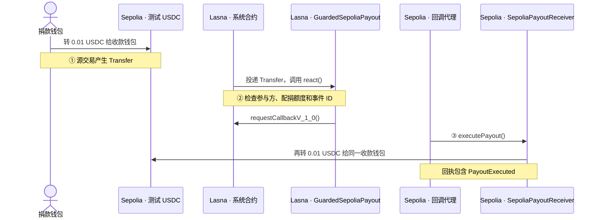

# Reactive Network Omni 共学

这里记录 Reactive Network Omni 的共学笔记和 Solidity 练习。现有练习通过 Reactive 合约监听 Sepolia 上的转账事件。

## 本地开发

按 [Foundry 官方指南](https://www.getfoundry.sh/introduction/installation) 安装后，在仓库根目录运行：

```sh
forge --version
cast --version
forge test
```

项目使用 Solidity `0.8.29` 和仓库内的 Reactive Omni 合约库。给 AI 编程工具的版本约束和参考文档见 [AGENTS.md](AGENTS.md)。

## 测试网

使用本期专用钱包，在 Ethereum Sepolia 领取测试 ETH，再按官方步骤兑换 Lasna 的 lREACT。测试钱包文件和密码保存在本地。 [Reactive 官方 faucet 指南](https://dev.reactive.network/reactive-mainnet#reactive-faucet)

## 共学笔记

每日打卡记录放在 [notes/](notes/)，合约和测试分别放在 [src/](src/) 与 [test/](test/)。

## 带保护的 Sepolia 回调付款

`GuardedSepoliaPayout` 只响应 Sepolia 上指定发送方向固定收款人发出的 USDC `Transfer`。每条符合条件的日志最多请求一次回调，`SepoliaPayoutReceiver` 从预存的测试 USDC 中向同一收款人支付等额款项。两端都按来源链 ID、交易哈希和日志索引组成的事件 ID 去重，并检查单次及合约生命周期总上限。金额使用 USDC 最小单位（`1 USDC = 1_000_000`）。

先在 Lasna 部署 `GuardedSepoliaPayout`，再在 Sepolia 部署 `SepoliaPayoutReceiver`。接收合约需要 Sepolia 回调代理、Lasna 合约地址，以及与 Lasna 合约相同的收款人和两项上限。分别准备 Lasna 的 lREACT 与 Sepolia 的 ETH 作为手续费，并向接收合约转入测试 USDC 作为付款资金。最后由 Lasna 合约的部署者调用一次 `activate(receiver)` 开启订阅。

[Foundry 测试](test/GuardedSepoliaPayout.t.sol)覆盖正常付款、重复投递、触发条件、两项金额上限和回调失败回滚。

### 第一条完整链路

用一笔 0.01 测试 USDC 捐款触发一笔等额配捐。源链和目标链均为 Ethereum Sepolia，判断在 Lasna 执行。Lasna 合约已部署，Sepolia 接收合约部署和三笔业务交易待完成。



| 项目 | 测试网记录 |
| --- | --- |
| 募捐钱包 | `0xAcF2cde557949A9189E304D9f255486F2997b55d` |
| 收款钱包 | `0x36183F4A182aB53d6EBD3B6039408a325A6DF986` |
| Lasna 合约 | `0x9cE32B963cAeA9437B96aC911a3e3b6C1Abf254F` |
| Lasna 部署 | [成功回执](https://lasna.reactscan.net/tx/0xa9c918121240fd50e8ed645eef8f986b37499efa764975bf390c721903f9299e)，手续费余额 0.04 lREACT |
| Ethereum Sepolia 回调代理 | `0xAa14d9Cd0f788Ca23d11805986C1d8bd035D23b4`，已通过 Sepolia RPC 核验链上代码 |
| ① 源链交易 | 待发出 Sepolia USDC 转账 |
| ② Reactive 交易 | 待生成 Lasna `CallbackRequest` |
| ③ 目标链交易 | 待生成 Sepolia `PayoutExecuted` |

本次部署的单笔和总上限均为 `10000`（0.01 测试 USDC），刚好够完成一次配捐。需要为募捐钱包准备 Sepolia ETH 和 0.02 测试 USDC，其中 0.01 用于为接收合约备款，另 0.01 用于触发捐款。Lasna 合约已存有 lREACT，领取的 Sepolia ETH 可留作接收合约部署和回调手续费。

验收时用源交易的 `Transfer` 日志索引和交易哈希，再加上链 ID `11155111` 计算事件 ID。Lasna 的 `CallbackRequest` 里应包含相同的事件 ID。用 `getCallbacks(reactiveTxHash)` 查目标交易哈希，并确认该交易包含同一事件 ID 的 `PayoutExecuted` 和接收合约发出的 USDC `Transfer`。 [Omni 回调查询](https://dev.reactive.network/economy#inspecting-callbacks)

### 出问题怎么办

- **手续费耗尽。** 预付额度和合约余额不足以付费并产生欠费时，Lasna 系统合约会自动停止投递源事件，Sepolia 回调代理也会对欠费的接收合约暂停投递。用 Lasna 系统合约的 `depositTo(reactiveAddress)` 充 lREACT，或用 Sepolia 回调代理的 `depositTo(receiverAddress)` 充 ETH。到对应链查 `debt(address)`，欠费归零即恢复服务。 [Omni 充值与欠费说明](https://dev.reactive.network/economy)
- **目标链执行失败。** 例如接收合约的测试 USDC 不足，付款会回滚，目标链的去重标记和已付金额保持原值。代理执行回调时发生的失败仍会计费，可查看 `CallbackFailure` 或用 Lasna 系统合约的 `getCallbacks(reactiveTxHash)` 查目标交易哈希和错误数据。Lasna 上已提交的请求继续占用请求额度，同一源事件重复送达也不会再次发起回调。修复失败原因后，只有回调代理重新投递原请求才会再次尝试付款。 [回调计费](https://dev.reactive.network/callback-contracts#paying-for-callbacks) · [回调状态查询](https://dev.reactive.network/economy#inspecting-callbacks)
