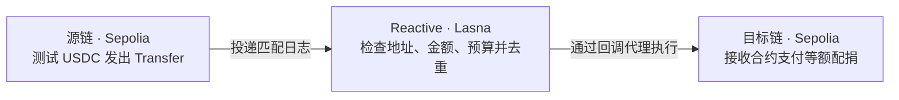

# 用例拆解卡：Sepolia USDC 自动配捐

我选了学习仓库里的[限额付款练习](../src/GuardedSepoliaPayout.sol)。设想一场测试募捐：指定的募捐钱包每向固定收款地址转一笔测试 USDC，预先注资的配捐合约就向同一地址补一笔等额的测试 USDC。

## 1. 监听哪条链、哪个合约的什么事件？

监听 Ethereum Sepolia（链 ID `11155111`）上测试 USDC 合约 `0x1c7D4B196Cb0C7B01d743Fbc6116a902379C7238` 发出的 `Transfer(address indexed from, address indexed to, uint256 value)`。订阅时就用 `from` 和 `to` 筛选指定的募捐钱包和固定收款地址。 [Omni 订阅规则](https://dev.reactive.network/reactive-contracts#subscriptions)

## 2. 满足什么条件时触发？

Lasna 上的 `GuardedSepoliaPayout` 在带 `onlySystem` 的 `react()` 中检查日志和金额。只有金额大于零、未超过单笔上限、且累计请求额加上本笔金额未超过总预算时，才申请回调。同一个事件以「源链 ID + 交易哈希 + 日志索引」识别，重复投递只会申请一次。比如单笔上限为 10 USDC、总预算为 100 USDC，已申请 96 USDC 时，新到的 5 USDC 捐款不会触发配捐。 [Omni 事件处理](https://dev.reactive.network/reactive-contracts#reacting-to-events)

## 3. 在哪条链做什么动作？

Lasna 合约调用 `SYSTEM.requestCallbackV_1_0()`，由 Sepolia 上的回调代理调用 `SepoliaPayoutReceiver.executePayout()`。接收合约验证回调代理和授权的 Lasna 合约，再检查事件是否已付款以及金额是否超限，最后从预存的测试 USDC 中支付等额配捐。这个用例的源链和目标链都是 Sepolia，监听和判断在 Lasna，配捐通过一笔独立的 Sepolia 交易完成。 [Omni 回调请求](https://dev.reactive.network/reactive-contracts#requesting-callbacks) · [回调鉴权](https://dev.reactive.network/callback-contracts#authorizing-callbacks)

## 4. 不用 Reactive 怎么做？它省了什么，代价是什么？

- **自己跑机器人。** 用 Sepolia RPC 持续监听转账，保存扫描进度和已处理的事件 ID，断线后补扫，再用签名钱包提交配捐交易并跟踪回执。交易量很小时也可以逐笔核对并手动付款。
- **用 Reactive。** 网络负责投递日志和提交回调交易，筛选条件、预算和去重记录由合约管理，省去维护常驻监听服务和自动付款签名钱包。 [Omni 事件与回调流程](https://dev.reactive.network/reactive-contracts#requesting-callbacks)
- **代价。** Lasna 合约需要 lREACT 支付 `react()` 的费用，Sepolia 接收合约需要 ETH 支付回调费用，并另备测试 USDC 用于配捐。回调失败仍会计费，欠费会暂停对应一侧的投递。捐款和配捐是独立交易，原始捐款到账后仍需看 `PayoutExecuted` 才能确认配捐已完成。 [Omni 计费与欠费](https://dev.reactive.network/economy) · [回调费用](https://dev.reactive.network/callback-contracts#paying-for-callbacks)
